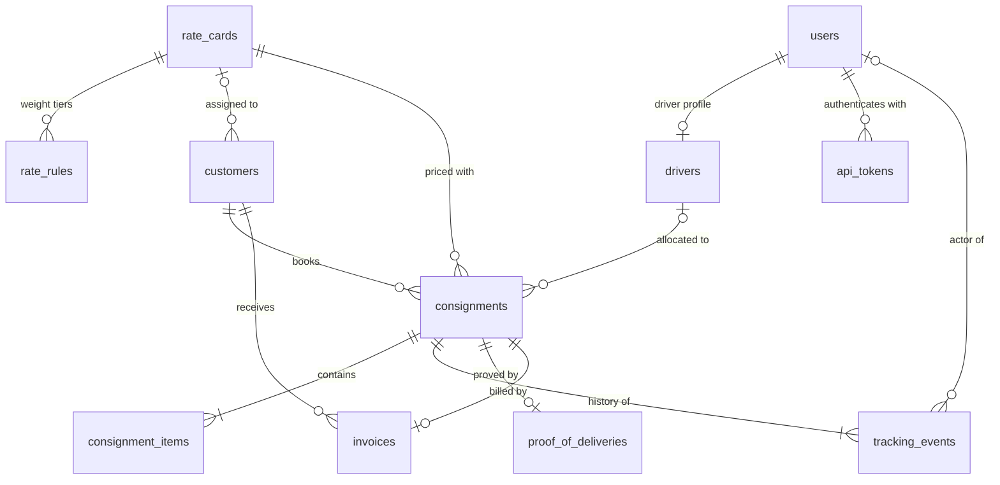
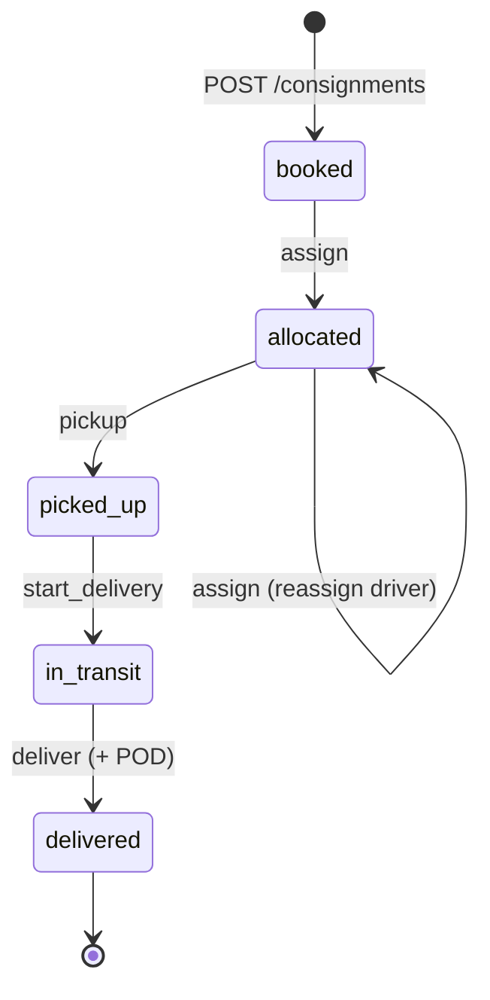

# FreightFlow — Architecture & Database Design

> FreightFlow is a simplified Transport Management System inspired by common real-world logistics workflows.
> It is a portfolio project and is not affiliated with any company.

This document is the design source of truth for the backend (Steps 3–8). The README summarises it.

---

## 1. System overview

```
 Flutter app ──────────────────┐
  • Driver screens (mobile)    ├── HTTPS + JSON, Bearer token ──▶  Rails API (/api/v1) ──▶ PostgreSQL
  • Dispatcher screens (web)   ┘                                        │                    ▲
                                                                        │ enqueue            │
                                                                        │ (after COMMIT)     │
                                                                        ▼                    │
                                                                      Redis ──▶ Sidekiq ─────┘
                                                                                GenerateInvoiceJob
                                                                                SendDeliveryNotificationJob
```

- **Rails API-only app**: the only client is the Flutter app, so there are no views, cookies or asset pipeline.
- **One Flutter codebase, two roles.** After login the app reads the user's `role` and shows either the driver screens or the dispatcher screens. Models, the API client and authentication are shared, which avoids two apps duplicating the same JSON parsing.
  - **Driver:** my jobs → job details → pickup / in transit / deliver → proof of delivery → tracking timeline. Runs on a phone or simulator.
  - **Dispatcher:** consignment board (filter by status) → book a consignment with a live price quote → assign or reassign a driver → view the timeline, POD and invoice. Runs as Flutter web in a desktop browser.
- **CORS** is enabled for `/api/*` because Flutter web runs in a browser on another origin. Native mobile builds aren't affected.

## 2. Repository layout

```
freightflow/
├── backend/              Rails API
├── frontend/             Flutter app (driver + dispatcher screens)
├── docs/architecture.md  this file
├── .github/workflows/    CI: Brakeman, bundler-audit, RuboCop, RSpec
├── docker-compose.yml    Rails + Sidekiq + PostgreSQL + Redis   (Step 11)
└── README.md                                                     (Step 12)
```

## 3. Backend layering

```
app/
├── controllers/api/v1/        HTTP only: authenticate, authorize, permit params, call a service, render
├── services/                  one class per business action; owns transactions and job enqueueing
│   ├── consignments/          create.rb, assign_driver.rb, transition.rb, deliver.rb
│   ├── pricing/               freight_calculator.rb, rate_card_resolver.rb, quote.rb
│   └── invoices/              generate.rb
├── models/                    associations, validations, scopes; no workflow logic
│   └── consignment/status_flow.rb   PORO: the allowed-transitions table
├── jobs/                      thin: load the record, call a service
└── serializers/               plain Ruby: model → JSON hash
```

Rules the codebase follows:

1. Controllers stay thin. Anything that touches more than one table or has business rules is a service.
2. Only the consignment services change `status`. Rails enum bang methods (`consignment.delivered!`) are never used, because they skip transition rules, tracking events and proof of delivery.
3. Services raise domain errors. `Api::V1::BaseController` converts them to the error envelope (§9) with `rescue_from`.
4. Money is `BigDecimal` from the database to the JSON response and is serialised as a string (`"328.25"`).
5. Jobs are enqueued **after** the transaction commits, never inside it.

## 4. Domain model



| Model | Business meaning |
|---|---|
| `User` | A login: `dispatcher` or `driver`. Added for authentication. |
| `ApiToken` | A revocable bearer token issued at login. Added for authentication. |
| `Driver` | Operational profile of a driver: phone, vehicle, active flag. One per driver user. |
| `Customer` | A shipper who books freight. Optionally has its own rate card. |
| `RateCard` | A tariff: base charge, minimum charge, fuel levy %, cubic factor. Can be shared by many customers. One card is the default. |
| `RateRule` | A weight tier on a rate card: "from X kg, charge $Y per kg". |
| `Consignment` | One booked shipment: addresses, totals, current status, price snapshot. |
| `ConsignmentItem` | A line of freight: "2 × pallet, 120×120×100 cm, 180 kg each". |
| `TrackingEvent` | Append-only history entry: what happened, when, where, by whom. |
| `ProofOfDelivery` | Receiver name, time and notes captured at delivery. At most one per consignment. |
| `Invoice` | Bill for a delivered consignment. At most one per consignment. |

## 5. Table specifications

Conventions: `bigint` primary keys (Rails default). Every foreign key has a real `FOREIGN KEY` constraint and an index. `timestamps` means `created_at` and `updated_at`, both `NOT NULL`. Rails stores times in UTC.

### users
| Column | Type | Constraints | Notes |
|---|---|---|---|
| name | string | NOT NULL | |
| email | string | NOT NULL, UNIQUE | lower-cased by Rails `normalizes` before it reaches the index |
| password_digest | string | NOT NULL | `has_secure_password` (bcrypt) |
| role | string | NOT NULL, CHECK in (`dispatcher`, `driver`) | |
| timestamps | | | |

### api_tokens
| Column | Type | Constraints | Notes |
|---|---|---|---|
| user_id | bigint | NOT NULL, FK → users ON DELETE CASCADE | |
| token_digest | string | NOT NULL, UNIQUE | SHA-256 of the token. The raw token is returned once at login and never stored. |
| expires_at | datetime | NOT NULL | |
| last_used_at | datetime | NULL | |
| timestamps | | | |

### drivers
| Column | Type | Constraints | Notes |
|---|---|---|---|
| user_id | bigint | NOT NULL, FK, UNIQUE | one login per driver |
| phone | string | NOT NULL | |
| vehicle_registration | string | NOT NULL | |
| active | boolean | NOT NULL, default `true` | inactive drivers cannot be assigned (service rule) |
| timestamps | | | |

### customers
| Column | Type | Constraints | Notes |
|---|---|---|---|
| name | string | NOT NULL | |
| code | string | NOT NULL, UNIQUE | short account code, e.g. `ACME` |
| billing_email | string | NOT NULL | delivery notification recipient |
| rate_card_id | bigint | NULL, FK | `NULL` means "use the default rate card" |
| timestamps | | | |

### rate_cards
| Column | Type | Constraints | Notes |
|---|---|---|---|
| name | string | NOT NULL, UNIQUE | |
| is_default | boolean | NOT NULL, default `false` | partial unique index `WHERE is_default` allows at most one default |
| base_charge | decimal(10,2) | NOT NULL, CHECK ≥ 0 | |
| minimum_charge | decimal(10,2) | NOT NULL, CHECK ≥ 0 | |
| fuel_levy_percent | decimal(5,2) | NOT NULL, CHECK ≥ 0 | `18.50` means 18.5 % |
| cubic_conversion_factor | integer | NOT NULL, default `250`, CHECK > 0 | kg per m³ |
| timestamps | | | |

### rate_rules
| Column | Type | Constraints | Notes |
|---|---|---|---|
| rate_card_id | bigint | NOT NULL, FK | |
| min_weight_kg | decimal(10,3) | NOT NULL, CHECK ≥ 0 | the tier starts here and applies until the next tier |
| per_kg_rate | decimal(10,4) | NOT NULL, CHECK ≥ 0 | 4 dp because rates like $0.4575/kg are normal |
| timestamps | | | |

UNIQUE `(rate_card_id, min_weight_kg)`.

Tiers are **thresholds, not ranges**. Without a `max_weight_kg` column, tiers can't overlap and can't leave gaps, so the unique index is all the integrity this table needs.

### consignments
| Column | Type | Constraints | Notes |
|---|---|---|---|
| customer_id | bigint | NOT NULL, FK | |
| driver_id | bigint | NULL, FK | `NULL` until allocated |
| rate_card_id | bigint | NOT NULL, FK | the card used for pricing (audit trail) |
| reference | string | NOT NULL | the customer's own reference, e.g. `PO-1001` |
| status | string | NOT NULL, default `booked`, CHECK in (§6) | current state only; history is in `tracking_events` |
| pickup_address_line1, pickup_suburb, pickup_state, pickup_postcode | string | NOT NULL | snapshot, not a FK to a shared address |
| delivery_address_line1, delivery_suburb, delivery_state, delivery_postcode | string | NOT NULL | snapshot |
| delivery_instructions | text | NULL | shown to the driver, e.g. "Dock 3, ask for Sam" |
| requested_delivery_date | date | NOT NULL | |
| total_items | integer | NOT NULL, CHECK > 0 | Σ item quantity |
| total_weight_kg | decimal(10,3) | NOT NULL, CHECK > 0 | Σ item weight × quantity |
| total_volume_m3 | decimal(10,3) | NOT NULL, CHECK ≥ 0 | tiny parcels can round to 0.000 |
| chargeable_weight_kg | decimal(10,3) | NOT NULL, CHECK > 0 | pricing snapshot |
| freight_charge | decimal(12,2) | NOT NULL, CHECK ≥ 0 | pricing snapshot |
| fuel_levy_percent | decimal(5,2) | NOT NULL, CHECK ≥ 0 | pricing snapshot: the % in force at booking |
| fuel_levy_amount | decimal(12,2) | NOT NULL, CHECK ≥ 0 | pricing snapshot |
| total_charge | decimal(12,2) | NOT NULL, CHECK = freight_charge + fuel_levy_amount | pricing snapshot |
| delivery_notified_at | datetime | NULL | set by the notification job (idempotency) |
| timestamps | | | |

Indexes: UNIQUE `(customer_id, reference)`, `(driver_id, status)` for the driver's job list, `(status)` for dispatcher filtering, `(rate_card_id)`.

Totals are **denormalised on purpose**. Items don't change after booking, the price was calculated from these exact totals, and list endpoints don't need to aggregate items.

### consignment_items
| Column | Type | Constraints | Notes |
|---|---|---|---|
| consignment_id | bigint | NOT NULL, FK | |
| description | string | NOT NULL | "Pallet – office chairs" |
| quantity | integer | NOT NULL, CHECK > 0 | |
| weight_kg | decimal(10,3) | NOT NULL, CHECK > 0 | **per unit**, not per line |
| length_cm, width_cm, height_cm | integer | NOT NULL, CHECK > 0 | per unit |
| timestamps | | | |

### tracking_events
| Column | Type | Constraints | Notes |
|---|---|---|---|
| consignment_id | bigint | NOT NULL, FK | |
| user_id | bigint | NULL, FK | who caused it; `NULL` for system events |
| event_type | string | NOT NULL, CHECK in (`status_changed`, `driver_reassigned`) | what kind of thing happened |
| status | string | NOT NULL, CHECK in (§6) | the consignment's status **after** this event |
| occurred_at | datetime | NOT NULL | when it happened on the road (from the device) |
| latitude | decimal(9,6) | NULL, CHECK between −90 and 90 | |
| longitude | decimal(9,6) | NULL, CHECK between −180 and 180 | |
| metadata | jsonb | NOT NULL, default `{}` | e.g. `{ "driver_id": 3, "driver_name": "Mia" }` |
| created_at | datetime | NOT NULL | when the server recorded it; there is **no `updated_at`** |

CHECK `(latitude IS NULL) = (longitude IS NULL)`, so coordinates come as a pair or not at all.
Index `(consignment_id, occurred_at)` serves the timeline query and its ordering.

`event_type` and `status` are separate columns because they answer different questions. A reassignment is a real event (`driver_reassigned`) that leaves status at `allocated`. Future GPS pings (`location_update`) would leave status at `in_transit`.

### proof_of_deliveries
| Column | Type | Constraints | Notes |
|---|---|---|---|
| consignment_id | bigint | NOT NULL, FK, **UNIQUE** | one POD per consignment |
| receiver_name | string | NOT NULL | |
| delivered_at | datetime | NOT NULL | |
| notes | text | NULL | |
| timestamps | | | |

### invoices
| Column | Type | Constraints | Notes |
|---|---|---|---|
| consignment_id | bigint | NOT NULL, FK, **UNIQUE** | one invoice per consignment: the idempotency guarantee |
| customer_id | bigint | NOT NULL, FK | copied: the invoice is a document in its own right |
| invoice_number | string | generated, UNIQUE | `INV-000042`: a stored generated column, `'INV-' \|\| lpad(id::text, 6, '0')` |
| freight_charge | decimal(12,2) | NOT NULL, CHECK ≥ 0 | copied from the consignment snapshot, not recalculated |
| fuel_levy_amount | decimal(12,2) | NOT NULL, CHECK ≥ 0 | |
| total_amount | decimal(12,2) | NOT NULL, CHECK = freight_charge + fuel_levy_amount | |
| issued_at | datetime | NOT NULL | |
| timestamps | | | |

The number is derived from the row's `id`. The `id` comes from a PostgreSQL sequence, so the number is concurrency-safe, unlike `MAX(invoice_number) + 1`, which two jobs can compute at the same moment. Ruby code never sets it, so it can't be forgotten.

A separate `CREATE SEQUENCE` was considered and rejected: Rails' `schema.rb` doesn't record standalone sequences, so the test database would be created without it. A rolled-back transaction leaves a gap in the numbering. That is acceptable: invoice numbers must be unique, not gapless.

## 6. Consignment lifecycle



| Command | From → To | Actor | Written in one transaction | Enqueued after commit |
|---|---|---|---|---|
| book | – → `booked` | dispatcher | consignment, items, price snapshot, event | – |
| assign | `booked` → `allocated` | dispatcher | driver_id, event `status_changed` | – |
| reassign | `allocated` → `allocated` | dispatcher | driver_id, event `driver_reassigned` | – |
| pickup | `allocated` → `picked_up` | assigned driver | status, event | – |
| start_delivery | `picked_up` → `in_transit` | assigned driver | status, event | – |
| deliver | `in_transit` → `delivered` | assigned driver | status, POD, event | invoice job, notification job |

Implementation: `Consignment::StatusFlow` is a plain hash of allowed transitions with an `allowed?(from, to)` check. Services consult it while holding the row lock.

**Retries are no-ops.** Mobile networks drop responses, and the app will retry. If the consignment is already in the requested target status, the command returns `200` with the current state and writes nothing. A retried `deliver` returns the existing POD. Any other disallowed move (e.g. `booked → delivered`) is `409 invalid_transition`.

### Current status vs event history
- `consignments.status` is the **current** state. It's a plain column, fast to filter ("all jobs in transit").
- `tracking_events` is the **history**: every change with time, place and actor. Rows are only inserted. The model is read-only once persisted, and a correction is a new event.
- Both are written in the same transaction, so they cannot disagree. This is an audit log, **not event sourcing**: status is never rebuilt from events.
- `occurred_at` (device time) vs `created_at` (server time): a driver in a dead zone delivers at 13:40, and the app syncs at 14:05. The timeline shows 13:40.

## 7. Freight pricing

`Pricing::RateCardResolver` picks the card: `customer.rate_card`, otherwise the default card, otherwise raise `Pricing::MissingRateCard`.
`Pricing::FreightCalculator` is a pure function: rate card + measurements in, `Pricing::Quote` value object out, with no database writes.

```
dead_weight_kg   = Σ item.weight_kg × item.quantity
volume_m3        = round3( Σ (L × W × H cm ÷ 1,000,000) × item.quantity )
cubic_weight_kg  = volume_m3 × rate_card.cubic_conversion_factor          # 250 kg/m³
chargeable_kg    = ceil( max(dead_weight_kg, cubic_weight_kg) )           # carriers bill whole kg
rule             = tier with the highest min_weight_kg ≤ chargeable_kg    # else NoApplicableRateRule
freight_charge   = round2( max(base_charge + chargeable_kg × rule.per_kg_rate, minimum_charge) )
fuel_levy_amount = round2( freight_charge × fuel_levy_percent ÷ 100 )
total_charge     = freight_charge + fuel_levy_amount
```

- All intermediate values are `BigDecimal`. Rounding is half-up and happens only where written.
- The whole chargeable weight is charged at the matched tier's rate. This is standard weight-break pricing, not progressive like tax brackets.
- Price is snapshotted on the consignment. A later fuel levy change doesn't reprice existing bookings, and invoices copy the snapshot.

### Worked examples (these become the calculator specs)

Rate card: base $25.00, minimum $45.00, fuel levy 18.50 %, cubic factor 250. Tiers: 0 kg @ $0.5500, 100 kg @ $0.4200, 500 kg @ $0.3500.

| Case | Dead | Volume | Cubic | Chargeable | Freight | Levy | Total |
|---|---|---|---|---|---|---|---|
| 2 pallets 120×120×100 cm, 180 kg each | 360 kg | 2.880 m³ | 720 kg | 720 kg @ 0.35 | 25 + 252.00 = **277.00** | 51.245 → **51.25** | **328.25** |
| 1 carton 30×30×30 cm, 3 kg | 3 kg | 0.027 m³ | 6.75 kg | 7 kg @ 0.55 | 28.85 → minimum **45.00** | 8.325 → **8.33** | **53.33** |

Edge cases to cover in the specs: zero or negative weight (rejected), minimum charge, half-up rounding at .xx5, missing rate card, customer-specific vs default card, and a fuel levy change that leaves existing consignments untouched.

## 8. Transactions, concurrency, idempotency

### The deliver transaction
1. `BEGIN`, then `SELECT … FOR UPDATE` on the consignment row (`consignment.with_lock`, which also reloads it).
2. If the status is already `delivered`, stop: this is a retry. Return the existing POD.
3. Check that `in_transit → delivered` is allowed. If not, raise `InvalidTransition` and roll back.
4. Update the status, insert the POD, insert the tracking event.
5. `COMMIT`.
6. **Only if this request performed the delivery**, enqueue `GenerateInvoiceJob` and `SendDeliveryNotificationJob`.

If any insert fails, all of step 4 rolls back. There is never a delivered consignment without a POD and an event.

### Two requests updating the same consignment
- **Chosen: pessimistic lock** (`with_lock`). The second request waits a few milliseconds, then sees the committed state and becomes a no-op or a `409`. Transitions are short, so the lock is held briefly.
- **Not chosen: optimistic lock** (`lock_version`). It suits long "load form → edit → save" flows, where waiting is impossible and a stale-write `409` is the right answer. For a driver's retry, it would turn a success into an error. There's no `lock_version` column because nothing in scope needs it.
- **Safety net:** the unique indexes on `proof_of_deliveries.consignment_id` and `invoices.consignment_id` hold even if code bypasses the service.

### Background job idempotency
Assume every job can run **twice** (a retry after a partial failure) and occasionally **not at all** (an enqueue after commit fails, or open-source Sidekiq is hard-killed mid-job).

| Job | Duplicate protection | Missed-run protection |
|---|---|---|
| `GenerateInvoiceJob` | returns early if an invoice exists; the unique index plus `rescue ActiveRecord::RecordNotUnique` handles two jobs racing | reconciliation task: delivered consignments without an invoice (`LEFT JOIN … WHERE invoices.id IS NULL`) |
| `SendDeliveryNotificationJob` | claims the send with `UPDATE consignments SET delivery_notified_at = now() WHERE id = ? AND delivery_notified_at IS NULL`; only the job that updated 1 row sends | acceptable to miss for a simulated notification; a real system would log or alert |

Jobs receive IDs, not objects, so the job reloads current state when it runs.

## 9. API surface (details in Step 6)

| Method & path | Allowed | Purpose | Success |
|---|---|---|---|
| `POST /api/v1/session` | anyone (rate-limited: 10 per 3 min per IP) | log in, returns a token and the user (with `role`) | 201 |
| `DELETE /api/v1/session` | authenticated | log out (revoke this token) | 204 |
| `GET /api/v1/me` | authenticated | current user; the app calls it on startup to check a saved token and pick the screens | 200 |
| `GET /api/v1/customers` | dispatcher | customer picker on the booking form | 200 |
| `GET /api/v1/drivers` | dispatcher | driver picker for assignment (active drivers, with active job count) | 200 |
| `POST /api/v1/quotes` | dispatcher | price preview on the booking form; runs the calculator and saves nothing | 200 |
| `GET /api/v1/invoices` | dispatcher | invoice list, filter by customer, paginated | 200 |
| `GET /api/v1/consignments` | dispatcher | list, filter by `status` / `customer_id`, paginated | 200 |
| `POST /api/v1/consignments` | dispatcher | book and price | 201 |
| `GET /api/v1/consignments/:id` | dispatcher, assigned driver | detail | 200 |
| `POST /api/v1/consignments/:id/assign` | dispatcher | allocate or reassign | 200 |
| `POST /api/v1/consignments/:id/pickup` | assigned driver | `allocated → picked_up` | 200 |
| `POST /api/v1/consignments/:id/start_delivery` | assigned driver | `picked_up → in_transit` | 200 |
| `POST /api/v1/consignments/:id/deliver` | assigned driver | `in_transit → delivered`, body carries the POD | 200 |
| `GET /api/v1/consignments/:id/tracking_events` | dispatcher, assigned driver | timeline | 200 |
| `GET /api/v1/consignments/:id/proof_of_delivery` | dispatcher, assigned driver | POD | 200 / 404 |
| `GET /api/v1/drivers/:id/jobs` | dispatcher, or that driver only | active jobs | 200 |

Error envelope (every non-2xx response):

```json
{
  "error": {
    "code": "validation_failed",
    "message": "Consignment could not be created",
    "details": { "reference": ["has already been taken"] }
  }
}
```

| Condition | HTTP | `code` |
|---|---|---|
| missing or invalid token | 401 | `unauthorized` |
| wrong role, or not the assigned driver | 403 | `forbidden` |
| record not found | 404 | `not_found` |
| missing top-level param | 400 | `bad_request` |
| model validation failed | 422 | `validation_failed` |
| no rate card or rate rule | 422 | `pricing_unavailable` |
| inactive driver assigned | 422 | `driver_unavailable` |
| wrong email or password | 401 | `invalid_credentials` |
| too many login attempts | 429 | `rate_limited` |
| unique index fired (two identical requests raced) | 409 | `conflict` |
| disallowed status transition | 409 | `invalid_transition` |

## 10. Rails validations vs database constraints

Rule of thumb: **validations produce user-facing messages; constraints protect the truth.** When breaking a rule would corrupt money or duplicate a business record, the database enforces it too. Validations can race (uniqueness is SELECT-then-INSERT) and can be bypassed (`update_column`, `insert_all`, the console, a second app).

| Rule | Rails | Database | Why |
|---|---|---|---|
| Required fields | `presence` | NOT NULL | readable error + nothing bypasses it |
| Referenced rows exist | `belongs_to` | FOREIGN KEY | |
| Reference unique per customer | `uniqueness, scope:` | UNIQUE `(customer_id, reference)` | concurrent bookings can both pass the validation |
| Email unique | `uniqueness` | UNIQUE | same |
| One POD per consignment | `uniqueness` | UNIQUE | makes delivery idempotent |
| One invoice per consignment | — | UNIQUE | invoices are made by jobs, not user input; the index is the idempotency guarantee |
| Invoice number unique | — | UNIQUE + generated column | generated by the database, never typed |
| At most one default rate card | `uniqueness, conditions:` | partial UNIQUE | |
| Status is a known value | `enum … validate: true` | CHECK | |
| Positive weights, quantities, amounts | `numericality` | CHECK | static rules and cheap to enforce; they protect money calculations |
| total = freight + levy | — | CHECK | code computes it, the database double-checks |
| Coordinates in range, both or neither | `numericality` | CHECK | |
| Allowed status transitions | `StatusFlow` in services | — | depends on the previous value; a trigger would hide business logic in SQL |
| Requested delivery date not in the past (on create) | ✓ | — | time-dependent: a CHECK against today's date is re-evaluated on every UPDATE and on dump/restore, so it would reject valid old rows |
| `delivered_at` not in the future | ✓ | — | time-dependent |
| Driver must be active to be assigned | service | — | cross-table |
| Consignment has ≥ 1 item | ✓ | — | cross-table; SQL can't express it simply |
| A tier covers the chargeable weight | calculator raises | — | cross-row, computed at pricing time |

## 11. Decisions and alternatives

| Chosen | Over | Why |
|---|---|---|
| String `status` + CHECK + Rails enum | integer enum, PostgreSQL `ENUM` type | readable in SQL, safe to extend; integer enums break if reordered, PG enums are awkward to change |
| `StatusFlow` hash + service | AASM / state_machines gem | the machine is five transitions; the service shows every side effect in order instead of hiding them in callbacks |
| Opaque bearer token, digest stored | Devise, JWT | revocable (logout works), small, no gem; a JWT can't be revoked without a denylist |
| `bigint` primary keys | UUIDs | Rails default, smaller indexes; authorization, not obscure IDs, stops enumeration |
| `decimal` + `BigDecimal` | `float`, money-rails | exact arithmetic; single currency (AUD) so a money gem adds nothing |
| Plain Ruby serializers | ActiveModel::Serializers, Jbuilder | explicit and dependency-free |
| Exceptions + `rescue_from` | Result objects / dry-monads | idiomatic Rails, fewer concepts |
| Sidekiq | Solid Queue (Rails 8 default) | industry standard; Redis is already in the stack. Solid Queue is a valid DB-backed alternative. |
| Pessimistic lock for transitions | optimistic lock | see §8 |
| One Flutter app with role-based screens | separate driver and dispatcher apps | shared models, API client and auth; one codebase to explain |
| `POST /quotes` reuses `FreightCalculator` | pricing only inside booking | the calculator doesn't persist anything, so a price preview needs no extra logic |

## 12. Deliberate simplifications (and the upgrade path)

| Simplification | Real-world version |
|---|---|
| Single tenant | `accounts` table + `account_id` on every tenant-owned table, scoped via `Current.account` |
| One invoice per consignment | weekly billing runs: `Invoice has_many :invoice_lines` |
| Fuel levy % lives on the rate card | effective-dated fuel levy table (levies change monthly) |
| No GST | `tax_amount` on invoices (10 % in Australia) |
| Flat addresses, weight-only pricing | geocoding, postcode zones, lane-based (origin zone → destination zone) rates |
| Happy-path statuses only | `cancelled`, `failed_delivery` / futile, return-to-depot |
| Dispatcher books for the customer; no separate customer role or login | customer-portal users scoped to their own `customer_id` |
| POD without signature or photo | Active Storage attachments |
| Idempotent retries via natural keys and state | `Idempotency-Key` header for bookings |
